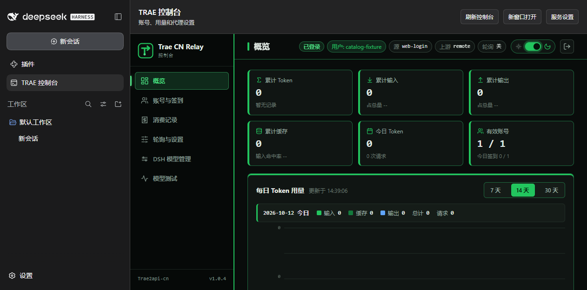
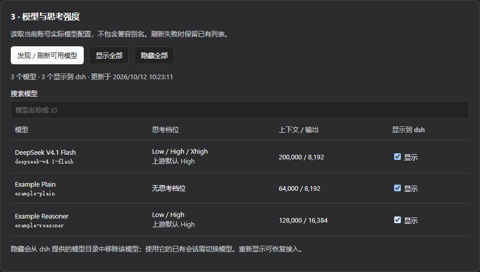
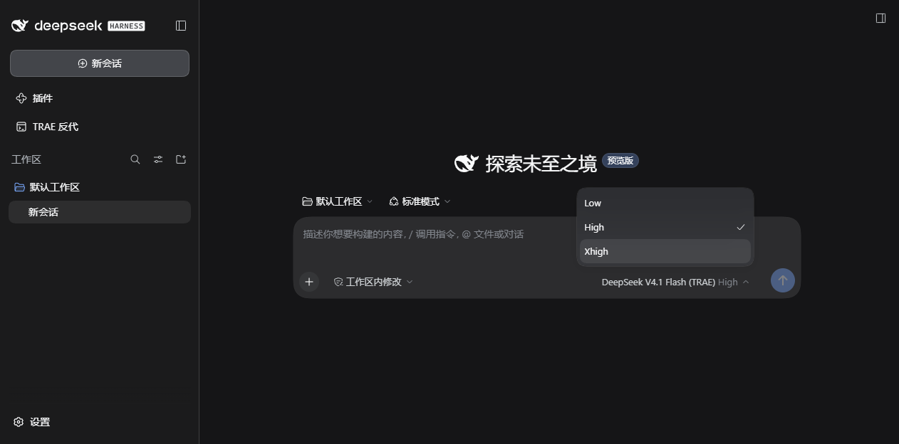

<p align="center">
  
</p>

<h1 align="center">Trae2api-dsh</h1>

<p align="center">把 TRAE 账号的模型额度接入 dsh，直接在 DeepSeek Harness 中使用。</p>

[](https://github.com/FuSheng-cs/Trae2api-dsh/releases/latest)
[](https://github.com/FuSheng-cs/Trae2api-dsh/actions/workflows/ci.yml)
[](LICENSE)

[English](README.en.md) · [下载](https://github.com/FuSheng-cs/Trae2api-dsh/releases/latest) · [使用指南](docs/usage.zh-CN.md) · [问题反馈](https://github.com/FuSheng-cs/Trae2api-dsh/issues)

**Trae2api-dsh** 让 dsh 使用你在 TRAE CN / TRAE SOLO CN 账号中的模型额度。导入账号后，即可在 dsh 原生对话菜单选择 TRAE 模型和思考强度，使用该账号的额度进行对话。内嵌控制台提供多账号管理、自动签到、账号轮询、用量统计和模型显示设置。

[功能](#功能) · [界面](#界面预览) · [快速开始](#快速开始) · [日常使用](#日常使用) · [常见问题](#常见问题) · [项目文档](#项目文档)

## 功能

| 功能 | 说明 |
| --- | --- |
| **TRAE 额度接入** | 导入 TRAE 账号，在 dsh 中调用账号提供的模型并使用其模型额度。 |
| **自动签到** | 按北京时间每日签到，跳过当天已签到账号；支持立即执行、上次与下次执行时间及结果查询。 |
| **多账号管理** | 导入已登录的桌面账号或网页授权登录，切换当前账号，分别启用或禁用模型调用。 |
| **账号轮询** | 在有效且启用的账号之间顺序轮询，或根据缓存的剩余积分排序调度。 |
| **模型与思考强度** | 预置 DeepSeek V4.1 Flash，发现账号的 Remote / SOLO 模型，按实际能力提供 Low / High / Xhigh。 |
| **模型显示管理** | 在控制台搜索、显示或隐藏模型，支持批量操作；刷新与重启后保留偏好，并同步至原生模型菜单。 |
| **积分与用量** | 查看账号积分、Token、缓存、请求、消费记录和每日汇总。 |
| **完整内嵌控制台** | 保留概览、账号与签到、消费记录、轮询与设置、模型测试；也可在浏览器新窗口打开。 |
| **服务自动管理** | 首次准备后随 dsh 启动；完整退出、Host 结束或禁用插件时回收整个代理进程树。 |

自动签到和轮询默认关闭，可在控制台按需开启。关闭窗口到托盘时服务继续运行。

## 界面预览



<details>
<summary>查看模型管理与思考强度菜单</summary>





</details>

截图使用隔离测试数据；实际模型列表由账号返回。

## 快速开始

### 环境要求

| 环境 | 要求 |
| --- | --- |
| dsh | 已验证 **0.2.0-rc.2**，本机 Desktop / Web |
| Node.js | **22+** |
| Python | **3.10+**，包含 `venv` 和 `pip` |
| 账号 | TRAE CN / TRAE SOLO CN，具有目标模型使用权限 |
| 操作系统 | Windows 10/11；Linux 和 macOS 通过 CI 验证 |

本机 Web / CLI 安装需要 `pnpm` 10+；Desktop 使用自带的插件管理环境。首次准备需要联网下载 Python 依赖，无需 Docker。

### 安装

**Desktop**：在 dsh 插件管理器的添加包入口输入以下地址，安装并启用后打开侧栏 **TRAE 控制台**。

```text
https://github.com/FuSheng-cs/Trae2api-dsh/releases/latest/download/trae2api-dsh.tgz
```

**本机 Web / CLI**：

```sh
dsh plugin --profile web add https://github.com/FuSheng-cs/Trae2api-dsh/releases/latest/download/trae2api-dsh.tgz
dsh web
```

可在 [Release](https://github.com/FuSheng-cs/Trae2api-dsh/releases/latest) 下载固定版本和 `SHA256SUMS.txt`。不同市场的收录情况见 [市场记录](MARKETPLACES.md)，未收录的市场可能限制安装来源。

### 首次配置

1. 打开 **TRAE 控制台 → 服务设置**，点击 **准备环境**，完成后点击 **启动服务**。
2. 选择 **TRAE SOLO CN** 或 **Trae CN**，点击 **导入当前桌面账号**；也可返回控制台使用网页授权登录。
3. 在 **DSH 模型管理** 点击 **接入 dsh 模型菜单**。
4. 在对话输入框选择模型和思考强度；模型显示或隐藏仍在控制台中管理。

首次启动不会自动导入账号。导入由你主动触发，TRAE 客户端登录文件保持只读。模型名称、可选档位与可用额度以账号返回为准。

## 日常使用

| 要做什么 | 控制台入口 |
| --- | --- |
| 添加、切换账号，设置模型调用开关 | **账号与签到** |
| 设置每日签到或立即执行 | **账号与签到 → 自动签到** |
| 开启顺序轮询或积分优先模式 | **轮询与设置 → 多账号轮询** |
| 刷新模型、搜索、逐个或批量显示/隐藏 | **DSH 模型管理** |
| 查看积分、Token 和消费记录 | **概览 / 消费记录** |
| 准备环境、启动或停止代理 | 顶部 **服务设置** |

积分优先模式使用已缓存的余额排序，可先在账号页刷新积分。隐藏模型会从 dsh 的模型目录移除该项，请先切换仍在使用它的会话；隐藏全部后，重新显示任一模型即可恢复。

## 运行与更新

插件使用独立 Python 环境和本机回环地址。准备完成后自动管理代理生命周期，保留其他供应商和全局模型默认值。账号副本、设置和显示偏好保存在插件自己的数据目录，更新会刷新运行文件并保留这些数据。

项目原名为 `dsh-trae-relay`。从旧包升级请先断开模型、停止并移除旧插件，再添加新包；数据目录和 credential 标识保持兼容。详细步骤见 [升级与数据管理](docs/usage.zh-CN.md#从旧包升级)。

## 常见问题

**关闭 dsh 窗口会停止代理吗？** 关闭到托盘时继续运行；完整退出 dsh、Host 结束或禁用插件时停止代理和签到任务。

**为什么模型列表或思考档位不同？** 插件读取当前账号返回的目录。未提供的档位不会显示，没有公布思考档位的模型使用上游默认行为。切换账号后刷新目录即可。

**端口被占用或找不到 Python 怎么办？** 在服务设置中填写可用的 Python 完整路径，或停止服务后选择空闲端口重新准备。网络下载与环境排查见 [使用指南](docs/usage.zh-CN.md)。

**支持国际版或远程浏览器吗？** 当前面向中国版协议和本机 Desktop / Web。完整控制台使用 Host 回环地址，远程浏览器场景尚未支持。

**卸载会删除账号吗？** 卸载保留插件数据。先断开模型、停止服务；需要彻底清理时再按使用指南移除数据与 credential。

## 项目文档

| 文档 | 内容 |
| --- | --- |
| [使用指南](docs/usage.zh-CN.md) | 详细配置、签到轮询、模型管理、存储、升级和卸载 |
| [贡献指南](CONTRIBUTING.md) | 目录结构、本地开发、隔离测试和发布流程 |
| [版本记录](CHANGELOG.md) | 各版本的变更 |
| [市场记录](MARKETPLACES.md) | 已上架渠道与待审申请 |

CI 在 Windows、Ubuntu、macOS 上验证插件测试、真实 dsh 安装、模型同步和服务退出回收；测试使用合成账号，不涉及个人凭据或付费推理。欢迎通过 [Issues](https://github.com/FuSheng-cs/Trae2api-dsh/issues) 报告问题。

---

反代引擎和原有管理界面来自 [autumnsentiment/Trae2api-cn](https://github.com/autumnsentiment/Trae2api-cn) v1.0.4，保留上游版权与许可。相关说明：[MIT 许可](LICENSE) · [第三方说明](THIRD_PARTY_NOTICES.md) · [使用边界与免责声明](DISCLAIMER.md)。
